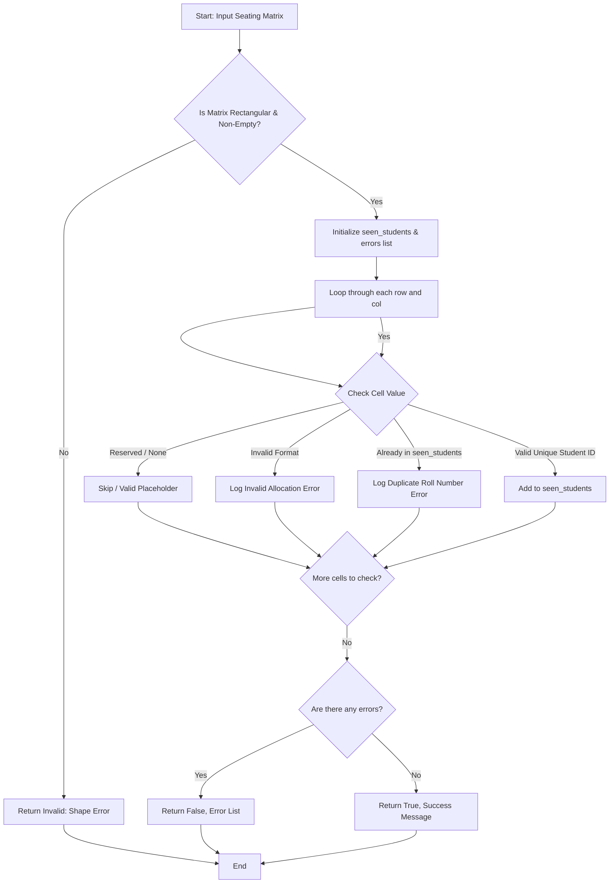

## Problem Statement

Design a validation system for an examination seating arrangement represented as a 2D list (nested list). The program must validate the seating matrix against four key constraints:

1. **Duplicate Roll Numbers:** Ensure no student roll number is allocated to more than one seat across the hall.
2. **Reserved Positions:** Check that seats marked as reserved (e.g., `None`, `"RESERVED"`, or empty spaces) are not incorrectly allocated to students.
3. **Empty Seats Handling:** Properly account for unassigned or empty seats in the matrix layout.
4. **Invalid Allocations:** Verify that student identifiers follow expected non-empty string formats and that the matrix dimensions form a uniform rectangular grid.

---

## Algorithm

1. **Input Validation:** Check if the input matrix is a non-empty 2D list and ensure all rows have uniform length (rectangular shape).
2. **State Initialization:** Define reserved seat markers and initialize an empty set (`seen_students`) to track unique roll numbers and a list to record validation errors.
3. **Matrix Traversal:** Iterate through each row and column of the seating matrix:
* If a cell matches a reserved or empty marker, skip or validate accordingly.
* If a cell contains an invalid format (non-string or empty string), log an invalid allocation error.
* If a student roll number already exists in `seen_students`, log a duplicate roll number error.
* Otherwise, add the student roll number to `seen_students`.


4. **Result Generation:** Return a boolean status indicating validity along with the collected error logs or success message.

---

## Flowchart



---

## Python Source Code

```python
def validate_seating_matrix(matrix, reserved_seats=None):
    if not matrix or not all(isinstance(row, list) for row in matrix):
        return False, ["Matrix is empty or not a valid 2D list."]
    
    row_length = len(matrix[0])
    if any(len(row) != row_length for row in matrix):
        return False, ["Matrix dimensions are irregular (non-rectangular)."]
    
    reserved = reserved_seats if reserved_seats is not None else {"RESERVED", None, ""}
    seen_students = set()
    errors = []
    
    for r_idx, row in enumerate(matrix):
        for c_idx, seat in enumerate(row):
            if seat in reserved:
                continue
            if not isinstance(seat, str) or not seat.strip():
                errors.append(f"Invalid student allocation at row {r_idx}, col {c_idx}: {seat}")
                continue
            
            if seat in seen_students:
                errors.append(f"Duplicate roll number '{seat}' found at row {r_idx}, col {c_idx}.")
            else:
                seen_students.add(seat)
            
    if errors:
        return False, errors
    return True, ["Seating matrix is valid."]

if __name__ == "__main__":
    seating_matrix = [
        ["ROLL101", "ROLL102", None],
        ["ROLL103", "RESERVED", "ROLL105"],
        ["ROLL101", "ROLL106", "ROLL107"]
    ]
    
    is_valid, messages = validate_seating_matrix(seating_matrix)
    print(f"Is Valid: {is_valid}")
    print("Messages:", messages)

```

---

## Sample Input

```python
seating_matrix = [
    ["ROLL101", "ROLL102", None],
    ["ROLL103", "RESERVED", "ROLL105"],
    ["ROLL101", "ROLL106", "ROLL107"]
]

```

---

## Sample Output

```json
{
  "is_valid": false,
  "messages": [
    "Duplicate roll number 'ROLL101' found at row 2, col 0."
  ]
}

```
