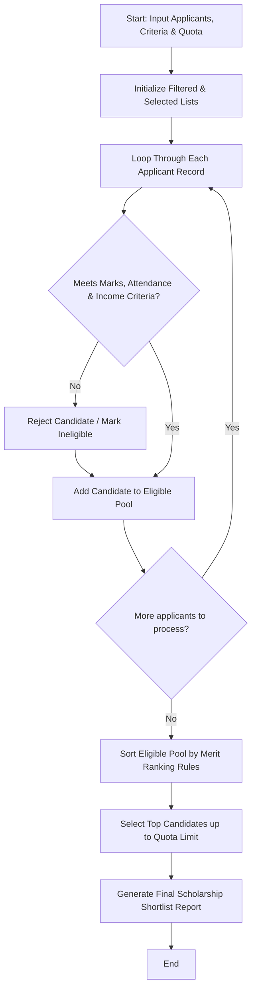

## Problem Statement

Design a multi-stage scholarship shortlisting system to process candidate applications. The program must evaluate students against minimum academic marks, attendance thresholds, and annual family income limits, rank the eligible candidates based on merit rules, and select a fixed quota of scholarship recipients.

---

## Algorithm

1. **Input Ingestion:** Accept applicant records, eligibility criteria (minimum marks, attendance, income limit), ranking criteria, and the total scholarship quota.
2. **Eligibility Filtering:** Iterate through each applicant to verify if they meet all minimum academic, attendance, and income requirements, and filter out non-compliant candidates.
3. **Merit Ranking:** Sort the filtered eligible candidates based on composite ranking rules (e.g., highest academic marks followed by lowest income).
4. **Quota Selection:** Select top candidates up to the specified scholarship quota limit while maintaining a waitlist if applicable.
5. **Report Generation:** Return the final list of selected scholarship recipients alongside the rejected or waitlisted candidates.

---

## Flowchart



---

## Python Source Code

```python
def shortlist_candidates(applicants, criteria, quota):
    eligible_applicants = []
    rejected_applicants = []
    
    for student, data in applicants.items():
        marks = data["marks"]
        attendance = data["attendance"]
        income = data["income"]
        
        if (marks >= criteria["min_marks"] and 
            attendance >= criteria["min_attendance"] and 
            income <= criteria["max_income"]):
            eligible_applicants.append({
                "student": student,
                "marks": marks,
                "attendance": attendance,
                "income": income
            })
        else:
            rejected_applicants.append(student)
            
    ranked_applicants = sorted(
        eligible_applicants,
        key=lambda x: (x["marks"], -x["income"]),
        reverse=True
    )
    
    selected_recipients = ranked_applicants[:quota]
    waitlist = ranked_applicants[quota:]
    
    return selected_recipients, waitlist, rejected_applicants

if __name__ == "__main__":
    criteria = {
        "min_marks": 75.0,
        "min_attendance": 80.0,
        "max_income": 500000.0
    }
    
    applicants_data = {
        "Student_1": {"marks": 88.5, "attendance": 85.0, "income": 400000.0},
        "Student_2": {"marks": 65.0, "attendance": 90.0, "income": 300000.0},
        "Student_3": {"marks": 92.0, "attendance": 92.0, "income": 450000.0},
        "Student_4": {"marks": 78.0, "attendance": 70.0, "income": 200000.0},
        "Student_5": {"marks": 85.0, "attendance": 88.0, "income": 350000.0}
    }
    
    scholarship_quota = 2
    selected, waitlisted, rejected = shortlist_candidates(applicants_data, criteria, scholarship_quota)
    print("Selected:", selected)
    print("Waitlisted:", waitlisted)
    print("Rejected:", rejected)

```

---

## Sample Input

```python
criteria = {
    "min_marks": 75.0,
    "min_attendance": 80.0,
    "max_income": 500000.0
}

applicants_data = {
    "Student_1": {"marks": 88.5, "attendance": 85.0, "income": 400000.0},
    "Student_2": {"marks": 65.0, "attendance": 90.0, "income": 300000.0},
    "Student_3": {"marks": 92.0, "attendance": 92.0, "income": 450000.0},
    "Student_4": {"marks": 78.0, "attendance": 70.0, "income": 200000.0},
    "Student_5": {"marks": 85.0, "attendance": 88.0, "income": 350000.0}
}

scholarship_quota = 2

```

---

## Sample Output

```json
{
  "selected": [
    {
      "student": "Student_3",
      "marks": 92.0,
      "attendance": 92.0,
      "income": 450000.0
    },
    {
      "student": "Student_1",
      "marks": 88.5,
      "attendance": 85.0,
      "income": 400000.0
    }
  ],
  "waitlisted": [
    {
      "student": "Student_5",
      "marks": 85.0,
      "attendance": 88.0,
      "income": 350000.0
    }
  ],
  "rejected": [
    "Student_2",
    "Student_4"
  ]
}

```
