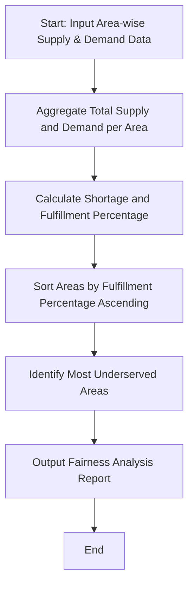

## Problem Statement

Design an analysis tool to evaluate water distribution fairness across multiple urban areas over several days. The program must ingest area-wise daily water supply and demand data, calculate cumulative shortages, determine fulfillment percentages, compare distribution equity, and rank the areas to identify the most underserved regions.

---

## Algorithm

1. **Data Ingestion:** Accept a dataset containing daily supply and demand figures for each designated area.
2. **Aggregation:** Sum up the total water supplied and total water demanded for each area across all recorded days.
3. **Shortage Calculation:** Compute the absolute shortage (`Demand - Supply`) and the percentage fulfillment (`(Supply / Demand) * 100`) for each area.
4. **Fairness Ranking:** Sort the areas in ascending order based on their fulfillment percentage to identify the most underserved regions.
5. **Report Generation:** Output the comparative distribution metrics and highlight the critical areas requiring priority water allocation.

---

## Flowchart



---

## Python Source Code

```python
def analyze_water_distribution(data):
    analysis_results = {}
    for area, records in data.items():
        total_supply = sum(r["supply"] for r in records)
        total_demand = sum(r["demand"] for r in records)
        shortage = max(0, total_demand - total_supply)
        fulfillment = (total_supply / total_demand * 100) if total_demand > 0 else 100.0
        analysis_results[area] = {
            "total_supply": total_supply,
            "total_demand": total_demand,
            "total_shortage": shortage,
            "fulfillment_percentage": round(fulfillment, 2)
        }
    
    sorted_areas = sorted(
        analysis_results.items(),
        key=lambda x: x[1]["fulfillment_percentage"]
    )
    
    return analysis_results, sorted_areas

if __name__ == "__main__":
    water_data = {
        "North Zone": [
            {"day": 1, "supply": 400, "demand": 500},
            {"day": 2, "supply": 450, "demand": 500},
            {"day": 3, "supply": 420, "demand": 480}
        ],
        "South Zone": [
            {"day": 1, "supply": 600, "demand": 600},
            {"day": 2, "supply": 580, "demand": 600},
            {"day": 3, "supply": 590, "demand": 610}
        ],
        "East Zone": [
            {"day": 1, "supply": 200, "demand": 450},
            {"day": 2, "supply": 250, "demand": 450},
            {"day": 3, "supply": 220, "demand": 460}
        ]
    }
    
    summary, ranked = analyze_water_distribution(water_data)
    print("Summary:", summary)
    print("Most Underserved Area:", ranked[0][0])

```

---

## Sample Input

```python
water_data = {
    "North Zone": [
        {"day": 1, "supply": 400, "demand": 500},
        {"day": 2, "supply": 450, "demand": 500},
        {"day": 3, "supply": 420, "demand": 480}
    ],
    "South Zone": [
        {"day": 1, "supply": 600, "demand": 600},
        {"day": 2, "supply": 580, "demand": 600},
        {"day": 3, "supply": 590, "demand": 610}
    ],
    "East Zone": [
        {"day": 1, "supply": 200, "demand": 450},
        {"day": 2, "supply": 250, "demand": 450},
        {"day": 3, "supply": 220, "demand": 460}
    ]
}

```

---

## Sample Output

```json
{
  "summary": {
    "North Zone": {
      "total_supply": 1270,
      "total_demand": 1480,
      "total_shortage": 210,
      "fulfillment_percentage": 85.81
    },
    "South Zone": {
      "total_supply": 1770,
      "total_demand": 1810,
      "total_shortage": 40,
      "fulfillment_percentage": 97.79
    },
    "East Zone": {
      "total_supply": 670,
      "total_demand": 1360,
      "total_shortage": 690,
      "fulfillment_percentage": 49.26
    }
  },
  "most_underserved_area": "East Zone"
}

```
