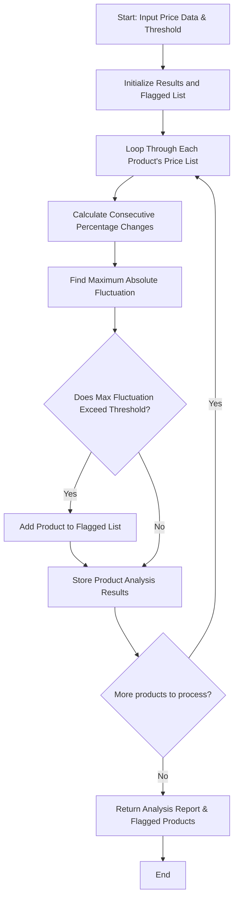

## Problem Statement

Design a price fluctuation analysis system to process historical price lists for multiple products over time. The program must calculate percentage changes between consecutive data points, identify the maximum absolute fluctuation for each product, and flag any products where price changes exceed a user-specified threshold percentage.

---

## Algorithm

1. **Input Ingestion:** Accept a dictionary of products mapped to their historical price lists and a float value representing the threshold percentage.
2. **Iteration:** Loop through each product and its corresponding price sequence.
3. **Percentage Change Calculation:** For each consecutive pair of prices, compute the percentage change using the formula: $\frac{\text{Current} - \text{Previous}}{\text{Previous}} \times 100$.
4. **Max Fluctuation Identification:** Determine the maximum absolute percentage change from the calculated changes for each product.
5. **Threshold Comparison:** Compare the maximum absolute fluctuation against the supplied threshold; if it exceeds the limit, add the product to the flagged list.
6. **Report Generation:** Return the detailed analysis metrics and the final list of flagged products.

---

## Flowchart



---

## Python Source Code

```python
def analyze_price_fluctuations(product_prices, threshold):
    analysis = {}
    flagged_products = []
    
    for product, prices in product_prices.items():
        if len(prices) < 2:
            analysis[product] = {"max_fluctuation": 0.0, "changes": []}
            continue
        
        changes = []
        for i in range(1, len(prices)):
            prev = prices[i - 1]
            curr = prices[i]
            if prev == 0:
                change = 0.0
            else:
                change = ((curr - prev) / prev) * 100
            changes.append(round(change, 2))
        
        max_fluctuation = max(changes, key=abs) if changes else 0.0
        
        analysis[product] = {
            "max_fluctuation": max_fluctuation,
            "changes": changes
        }
        
        if abs(max_fluctuation) > threshold:
            flagged_products.append(product)
            
    return analysis, flagged_products

if __name__ == "__main__":
    historical_prices = {
        "Product_A": [100.0, 105.0, 102.0, 115.0, 110.0],
        "Product_B": [50.0, 48.0, 45.0, 60.0, 58.0],
        "Product_C": [200.0, 202.0, 201.0, 203.0, 202.0]
    }
    threshold_value = 15.0
    
    results, flagged = analyze_price_fluctuations(historical_prices, threshold_value)
    print("Analysis:", results)
    print("Flagged Products:", flagged)

```

---

## Sample Input

```python
historical_prices = {
    "Product_A": [100.0, 105.0, 102.0, 115.0, 110.0],
    "Product_B": [50.0, 48.0, 45.0, 60.0, 58.0],
    "Product_C": [200.0, 202.0, 201.0, 203.0, 202.0]
}
threshold_value = 15.0

```

---

## Sample Output

```json
{
  "analysis": {
    "Product_A": {
      "max_fluctuation": 12.75,
      "changes": [5.0, -2.86, 12.75, -4.35]
    },
    "Product_B": {
      "max_fluctuation": 33.33,
      "changes": [-4.0, -6.25, 33.33, -3.33]
    },
    "Product_C": {
      "max_fluctuation": 1.0,
      "changes": [1.0, -0.5, 1.0, -0.49]
    }
  },
  "flagged_products": [
    "Product_B"
  ]
}

```
