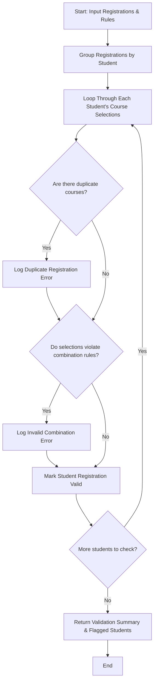

## Problem Statement

Design a validation system to check student course registrations represented as tuples. The program must identify duplicate course registrations per student, validate selections against disallowed or incompatible course combinations, and flag students whose selections violate the specified rules.

---

## Algorithm

1. **Input Ingestion:** Accept a collection of student course registrations (as tuples or lists of tuples) and a set of invalid or conflicting course combination rules.
2. **Student Record Grouping:** Map each student identifier to their selected list of courses.
3. **Duplicate Check:** Iterate through each student's course selections to verify if duplicate course codes exist within the same registration.
4. **Rule Violation Check:** Compare the student's registered course set against defined prerequisite or mutually exclusive combination rules.
5. **Report Generation:** Compile a list of non-compliant students with their specific violations (duplicates or illegal combinations) and return the validation status.

---

## Flowchart



---

## Python Source Code

```python
def validate_registrations(registrations, invalid_combinations):
    student_courses = {}
    for student, course in registrations:
        if student not in student_courses:
            student_courses[student] = []
        student_courses[student].append(course)
    
    violations = {}
    
    for student, courses in student_courses.items():
        student_violations = []
        
        if len(courses) != len(set(courses)):
            student_violations.append("Duplicate course registration found.")
            
        course_set = set(courses)
        for rule in invalid_combinations:
            if rule.issubset(course_set):
                student_violations.append(f"Invalid course combination: {list(rule)}")
                
        if student_violations:
            violations[student] = student_violations
            
    return violations

if __name__ == "__main__":
    registration_data = [
        ("Alice", "CS101"),
        ("Alice", "MA101"),
        ("Alice", "CS101"),
        ("Bob", "CS101"),
        ("Bob", "EE201"),
        ("Charlie", "PH101"),
        ("Charlie", "PH102")
    ]
    
    forbidden_rules = [
        {"CS101", "EE201"},
        {"PH101", "PH102"}
    ]
    
    invalid_records = validate_registrations(registration_data, forbidden_rules)
    print("Validation Violations:", invalid_records)

```

---

## Sample Input

```python
registration_data = [
    ("Alice", "CS101"),
    ("Alice", "MA101"),
    ("Alice", "CS101"),
    ("Bob", "CS101"),
    ("Bob", "EE201"),
    ("Charlie", "PH101"),
    ("Charlie", "PH102")
]

forbidden_rules = [
    {"CS101", "EE201"},
    {"PH101", "PH102"}
]

```

---

## Sample Output

```json
{
  "Alice": [
    "Duplicate course registration found."
  ],
  "Bob": [
    "Invalid course combination: ['CS101', 'EE201']"
  ],
  "Charlie": [
    "Invalid course combination: ['PH101', 'PH102']"
  ]
}

```
