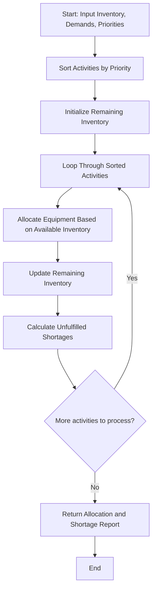

## Problem Statement

Design a resource allocation system to manage equipment distribution across multiple campus activities under limited stock constraints. The program must evaluate equipment requirements against available inventory, compute shortages for each activity, and distribute resources based on a defined priority order to produce a feasible allocation.

---

## Algorithm

1. **Input Ingestion:** Accept available equipment inventory, a list of activities with their requested equipment demands, and a priority ranking for each activity.
2. **Prioritization:** Sort the activities in descending order of their priority level.
3. **Allocation Loop:** Iterate through the sorted activities and fulfill equipment requests iteratively from the remaining available inventory.
4. **Shortage Calculation:** For each activity, calculate the shortage as the difference between requested demand and allocated equipment.
5. **Report Generation:** Return the final allocation summary along with the shortage metrics for each activity.

---

## Flowchart



---

## Python Source Code

```python
def allocate_resources(inventory, activities):
    remaining_inventory = inventory.copy()
    sorted_activities = sorted(activities, key=lambda x: x["priority"], reverse=True)
    allocations = {}
    
    for act in sorted_activities:
        name = act["name"]
        demands = act["demand"]
        allocated = {}
        for item, qty in demands.items():
            available = remaining_inventory.get(item, 0)
            given = min(qty, available)
            allocated[item] = given
            remaining_inventory[item] = available - given
        
        shortages = {item: demands[item] - allocated[item] for item in demands}
        allocations[name] = {
            "allocated": allocated,
            "shortage": shortages
        }
        
    return allocations, remaining_inventory

if __name__ == "__main__":
    available_inventory = {
        "Projectors": 3,
        "Laptops": 5,
        "Microphones": 4
    }
    
    activity_requests = [
        {"name": "Tech Symposium", "priority": 1, "demand": {"Projectors": 2, "Laptops": 4, "Microphones": 2}},
        {"name": "Cultural Fest", "priority": 3, "demand": {"Projectors": 2, "Laptops": 2, "Microphones": 3}},
        {"name": "Debate Club", "priority": 2, "demand": {"Projectors": 1, "Laptops": 1, "Microphones": 1}}
    ]
    
    results, left_over = allocate_resources(available_inventory, activity_requests)
    print("Allocations:", results)
    print("Remaining Inventory:", left_over)

```

---

## Sample Input

```python
available_inventory = {
    "Projectors": 3,
    "Laptops": 5,
    "Microphones": 4
}

activity_requests = [
    {"name": "Tech Symposium", "priority": 1, "demand": {"Projectors": 2, "Laptops": 4, "Microphones": 2}},
    {"name": "Cultural Fest", "priority": 3, "demand": {"Projectors": 2, "Laptops": 2, "Microphones": 3}},
    {"name": "Debate Club", "priority": 2, "demand": {"Projectors": 1, "Laptops": 1, "Microphones": 1}}
]

```

---

## Sample Output

```json
{
  "allocations": {
    "Cultural Fest": {
      "allocated": {
        "Projectors": 2,
        "Laptops": 2,
        "Microphones": 3
      },
      "shortage": {
        "Projectors": 0,
        "Laptops": 0,
        "Microphones": 0
      }
    },
    "Debate Club": {
      "allocated": {
        "Projectors": 1,
        "Laptops": 1,
        "Microphones": 1
      },
      "shortage": {
        "Projectors": 0,
        "Laptops": 0,
        "Microphones": 0
      }
    },
    "Tech Symposium": {
      "allocated": {
        "Projectors": 0,
        "Laptops": 2,
        "Microphones": 0
      },
      "shortage": {
        "Projectors": 2,
        "Laptops": 2,
        "Microphones": 2
      }
    }
  },
  "remaining_inventory": {
    "Projectors": 0,
    "Laptops": 0,
    "Microphones": 0
  }
}

```
