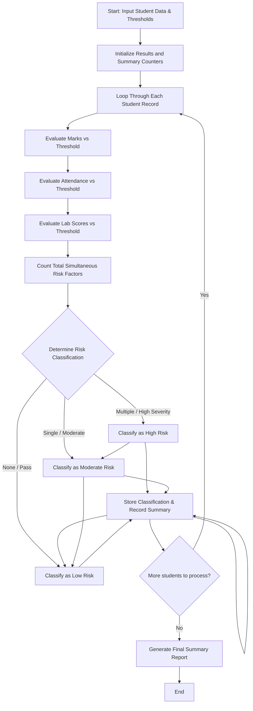

## Problem Statement

Design a student academic risk classification system that combines lists of academic marks, attendance percentages, and laboratory scores. The program must evaluate these metrics against predefined thresholds to classify students into distinct risk categories (e.g., High Risk, Moderate Risk, Low Risk), identify multiple simultaneous risk factors, and generate a comprehensive summary report.

---

## Algorithm

1. **Input Ingestion:** Accept student records containing marks, attendance, and laboratory scores along with specified risk criteria thresholds.
2. **Metric Evaluation:** Iterate through each student's profile to evaluate individual performance against thresholds for low marks, poor attendance, and low lab scores.
3. **Risk Factor Counting:** Tally the number of simultaneous risk factors triggered for each student.
4. **Category Assignment:** Assign a risk classification (High, Moderate, or Low) based on the accumulated count and severity of the risk factors.
5. **Summary Generation:** Compile the classified results into an aggregate summary report detailing counts per risk category.

---

## Flowchart



---

## Python Source Code

```python
def classify_student_risk(students_data, thresholds):
    classified_results = {}
    summary = {"High Risk": 0, "Moderate Risk": 0, "Low Risk": 0}
    
    for student, scores in students_data.items():
        marks = scores["marks"]
        attendance = scores["attendance"]
        lab_score = scores["lab_score"]
        
        risk_factors = []
        if marks < thresholds["marks"]:
            risk_factors.append("Low Marks")
        if attendance < thresholds["attendance"]:
            risk_factors.append("Low Attendance")
        if lab_score < thresholds["lab_score"]:
            risk_factors.append("Low Lab Score")
            
        num_factors = len(risk_factors)
        
        if num_factors >= 2:
            category = "High Risk"
        elif num_factors == 1:
            category = "Moderate Risk"
        else:
            category = "Low Risk"
            
        summary[category] += 1
        classified_results[student] = {
            "risk_factors": risk_factors,
            "category": category
        }
        
    return classified_results, summary

if __name__ == "__main__":
    thresholds = {
        "marks": 40.0,
        "attendance": 75.0,
        "lab_score": 50.0
    }
    
    student_records = {
        "Student_1": {"marks": 35.0, "attendance": 65.0, "lab_score": 45.0},
        "Student_2": {"marks": 85.0, "attendance": 90.0, "lab_score": 88.0},
        "Student_3": {"marks": 38.0, "attendance": 80.0, "lab_score": 60.0},
        "Student_4": {"marks": 30.0, "attendance": 50.0, "lab_score": 40.0}
    }
    
    results, summary_report = classify_student_risk(student_records, thresholds)
    print("Classifications:", results)
    print("Summary:", summary_report)

```

---

## Sample Input

```python
thresholds = {
    "marks": 40.0,
    "attendance": 75.0,
    "lab_score": 50.0
}

student_records = {
    "Student_1": {"marks": 35.0, "attendance": 65.0, "lab_score": 45.0},
    "Student_2": {"marks": 85.0, "attendance": 90.0, "lab_score": 88.0},
    "Student_3": {"marks": 38.0, "attendance": 80.0, "lab_score": 60.0},
    "Student_4": {"marks": 30.0, "attendance": 50.0, "lab_score": 40.0}
}

```

---

## Sample Output

```json
{
  "classifications": {
    "Student_1": {
      "risk_factors": ["Low Marks", "Low Attendance", "Low Lab Score"],
      "category": "High Risk"
    },
    "Student_2": {
      "risk_factors": [],
      "category": "Low Risk"
    },
    "Student_3": {
      "risk_factors": ["Low Marks"],
      "category": "Moderate Risk"
    },
    "Student_4": {
      "risk_factors": ["Low Marks", "Low Attendance", "Low Lab Score"],
      "category": "High Risk"
    }
  },
  "summary": {
    "High Risk": 2,
    "Moderate Risk": 1,
    "Low Risk": 1
  }
}

```
