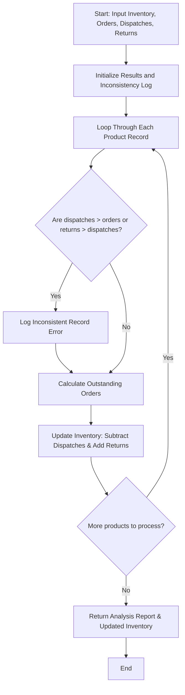

## Problem Statement

Design a retail order dispatch and return analysis system to process incoming order quantities, dispatch records, and returned items. The program must calculate outstanding orders, update inventory counts, and detect inconsistent records where returned quantities exceed dispatched quantities or dispatches exceed orders.

---

## Algorithm

1. **Input Ingestion:** Accept initial inventory levels along with records for orders, dispatches, and returns for each product.
2. **Consistency Validation:** Check each product record to detect anomalies such as dispatches exceeding ordered quantities or returns exceeding dispatched quantities, logging any inconsistencies.
3. **Outstanding Order Calculation:** Determine outstanding order quantities by subtracting total dispatches from total orders.
4. **Inventory Update:** Adjust inventory levels by subtracting dispatches and adding returned items back to stock.
5. **Report Generation:** Return the updated inventory status, calculated outstanding orders, and any detected data inconsistencies.

---

## Flowchart



---

## Python Source Code

```python
def analyze_retail_orders(inventory, records):
    updated_inventory = inventory.copy()
    analysis_results = {}
    inconsistencies = []
    
    for product, data in records.items():
        ordered = data.get("ordered", 0)
        dispatched = data.get("dispatched", 0)
        returned = data.get("returned", 0)
        
        product_errors = []
        if dispatched > ordered:
            product_errors.append("Dispatched quantity exceeds ordered quantity.")
        if returned > dispatched:
            product_errors.append("Returned quantity exceeds dispatched quantity.")
            
        if product_errors:
            inconsistencies.append({product: product_errors})
            continue
            
        outstanding = ordered - dispatched
        current_stock = updated_inventory.get(product, 0)
        new_stock = current_stock - dispatched + returned
        updated_inventory[product] = new_stock
        
        analysis_results[product] = {
            "outstanding_orders": outstanding,
            "updated_stock": new_stock
        }
        
    return analysis_results, updated_inventory, inconsistencies

if __name__ == "__main__":
    initial_inventory = {
        "Item_X": 100,
        "Item_Y": 50,
        "Item_Z": 200
    }
    
    order_records = {
        "Item_X": {"ordered": 40, "dispatched": 35, "returned": 5},
        "Item_Y": {"ordered": 20, "dispatched": 25, "returned": 2},
        "Item_Z": {"ordered": 60, "dispatched": 60, "returned": 0}
    }
    
    analysis, stock, errors = analyze_retail_orders(initial_inventory, order_records)
    print("Analysis:", analysis)
    print("Updated Inventory:", stock)
    print("Inconsistencies:", errors)

```

---

## Sample Input

```python
initial_inventory = {
    "Item_X": 100,
    "Item_Y": 50,
    "Item_Z": 200
}

order_records = {
    "Item_X": {"ordered": 40, "dispatched": 35, "returned": 5},
    "Item_Y": {"ordered": 20, "dispatched": 25, "returned": 2},
    "Item_Z": {"ordered": 60, "dispatched": 60, "returned": 0}
}

```

---

## Sample Output

```json
{
  "analysis": {
    "Item_X": {
      "outstanding_orders": 5,
      "updated_stock": 70
    },
    "Item_Z": {
      "outstanding_orders": 0,
      "updated_stock": 140
    }
  },
  "updated_inventory": {
    "Item_X": 70,
    "Item_Y": 50,
    "Item_Z": 140
  },
  "inconsistencies": [
    {
      "Item_Y": [
        "Dispatched quantity exceeds ordered quantity."
      ]
    }
  ]
}

```
