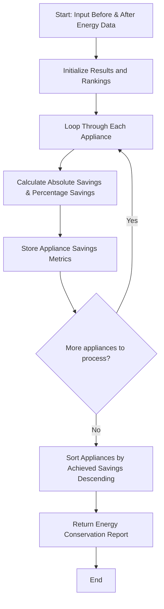

## Problem Statement

Design an energy conservation analysis tool to evaluate appliance-wise electricity consumption before and after an energy-saving intervention. The program must calculate the absolute and percentage energy savings for each appliance and rank them in descending order based on the highest achieved savings.

---

## Algorithm

1. **Input Ingestion:** Accept electricity consumption datasets containing pre-intervention and post-intervention usage figures for various appliances.
2. **Savings Calculation:** For each appliance, compute the absolute savings (`Before - After`) and the percentage savings using the formula: $\frac{\text{Before} - \text{After}}{\text{Before}} \times 100$.
3. **Ranking:** Sort the appliances in descending order of their percentage or absolute savings to highlight the most effective interventions.
4. **Report Generation:** Return the detailed comparison metrics and the ranked list of appliances.

---

## Flowchart



---

## Python Source Code

```python
def analyze_energy_conservation(energy_data):
    analysis_results = {}
    for appliance, data in energy_data.items():
        before = data["before"]
        after = data["after"]
        absolute_savings = before - after
        percentage_savings = (absolute_savings / before * 100) if before > 0 else 0.0
        
        analysis_results[appliance] = {
            "before": before,
            "after": after,
            "absolute_savings": round(absolute_savings, 2),
            "percentage_savings": round(percentage_savings, 2)
        }
    
    ranked_appliances = sorted(
        analysis_results.items(),
        key=lambda x: x[1]["absolute_savings"],
        reverse=True
    )
    
    return analysis_results, ranked_appliances

if __name__ == "__main__":
    energy_records = {
        "Air Conditioner": {"before": 450.0, "after": 320.0},
        "Refrigerator": {"before": 150.0, "after": 130.0},
        "Lighting": {"before": 80.0, "after": 40.0},
        "Washing Machine": {"before": 120.0, "after": 100.0}
    }
    
    analysis, rankings = analyze_energy_conservation(energy_records)
    print("Analysis:", analysis)
    print("Ranked Appliances:", rankings)

```

---

## Sample Input

```python
energy_records = {
    "Air Conditioner": {"before": 450.0, "after": 320.0},
    "Refrigerator": {"before": 150.0, "after": 130.0},
    "Lighting": {"before": 80.0, "after": 40.0},
    "Washing Machine": {"before": 120.0, "after": 100.0}
}

```

---

## Sample Output

```json
{
  "analysis": {
    "Air Conditioner": {
      "before": 450.0,
      "after": 320.0,
      "absolute_savings": 130.0,
      "percentage_savings": 28.89
    },
    "Refrigerator": {
      "before": 150.0,
      "after": 130.0,
      "absolute_savings": 20.0,
      "percentage_savings": 13.33
    },
    "Lighting": {
      "before": 80.0,
      "after": 40.0,
      "absolute_savings": 40.0,
      "percentage_savings": 50.0
    },
    "Washing Machine": {
      "before": 120.0,
      "after": 100.0,
      "absolute_savings": 20.0,
      "percentage_savings": 16.67
    }
  },
  "ranked_appliances": [
    ["Air Conditioner", {"before": 450.0, "after": 320.0, "absolute_savings": 130.0, "percentage_savings": 28.89}],
    ["Lighting", {"before": 80.0, "after": 40.0, "absolute_savings": 40.0, "percentage_savings": 50.0}],
    ["Refrigerator", {"before": 150.0, "after": 130.0, "absolute_savings": 20.0, "percentage_savings": 13.33}],
    ["Washing Machine", {"before": 120.0, "after": 100.0, "absolute_savings": 20.0, "percentage_savings": 16.67}]
  ]
}

```
