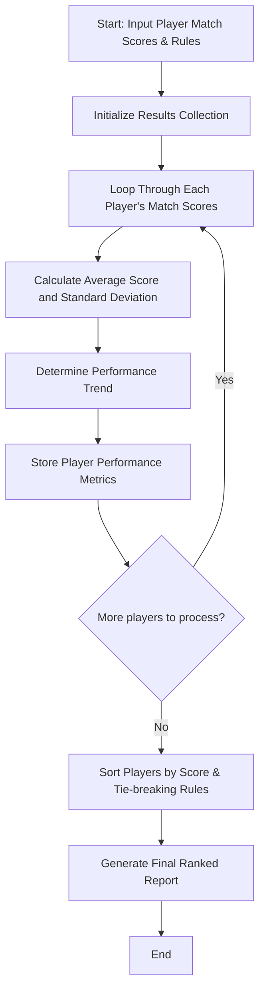

## Problem Statement

Design a sports performance analysis system to evaluate players' scores recorded across multiple matches stored in nested lists. The program must calculate consistency measures (such as standard deviation), identify performance trends (improving, declining, or stable), and rank players using supplied tie-breaking rules.

---

## Algorithm

1. **Input Ingestion:** Accept a dictionary mapping player names to their list of scores across successive matches, along with tie-breaking criteria weights or priorities.
2. **Metric Calculation:** For each player, compute average performance, consistency (using standard deviation), and total aggregate score.
3. **Trend Detection:** Analyze sequential match scores to determine if the player's performance trend is increasing, decreasing, or stable.
4. **Ranking:** Sort players based on primary performance metrics (e.g., average or total score) and apply tie-breaking rules (e.g., consistency or recent match scores).
5. **Report Generation:** Return the detailed performance analysis and final ranked list of players.

---

## Flowchart



---

## Python Source Code

```python
import statistics

def analyze_sports_performance(players_data):
    analysis_results = {}
    
    for player, scores in players_data.items():
        if not scores:
            continue
        avg_score = statistics.mean(scores)
        std_dev = statistics.pstdev(scores) if len(scores) > 1 else 0.0
        
        if len(scores) >= 2:
            if scores[-1] > scores[0]:
                trend = "Improving"
            elif scores[-1] < scores[0]:
                trend = "Declining"
            else:
                trend = "Stable"
        else:
            trend = "Single Match"
            
        analysis_results[player] = {
            "average_score": round(avg_score, 2),
            "consistency_std_dev": round(std_dev, 2),
            "trend": trend,
            "total_score": sum(scores)
        }
        
    ranked_players = sorted(
        analysis_results.items(),
        key=lambda x: (x[1]["average_score"], -x[1]["consistency_std_dev"]),
        reverse=True
    )
    
    return analysis_results, ranked_players

if __name__ == "__main__":
    match_scores = {
        "Player_A": [85, 90, 88, 92, 95],
        "Player_B": [70, 80, 75, 90, 95],
        "Player_C": [88, 87, 89, 88, 88],
        "Player_D": [60, 70, 65, 80, 75]
    }
    
    analysis, rankings = analyze_sports_performance(match_scores)
    print("Analysis:", analysis)
    print("Rankings:", rankings)

```

---

## Sample Input

```python
match_scores = {
    "Player_A": [85, 90, 88, 92, 95],
    "Player_B": [70, 80, 75, 90, 95],
    "Player_C": [88, 87, 89, 88, 88],
    "Player_D": [60, 70, 65, 80, 75]
}

```

---

## Sample Output

```json
{
  "analysis": {
    "Player_A": {
      "average_score": 90.0,
      "consistency_std_dev": 3.46,
      "trend": "Improving",
      "total_score": 450
    },
    "Player_B": {
      "average_score": 82.0,
      "consistency_std_dev": 9.27,
      "trend": "Improving",
      "total_score": 410
    },
    "Player_C": {
      "average_score": 88.0,
      "consistency_std_dev": 0.63,
      "trend": "Stable",
      "total_score": 440
    },
    "Player_D": {
      "average_score": 70.0,
      "consistency_std_dev": 7.07,
      "trend": "Improving",
      "total_score": 350
    }
  },
  "rankings": [
    ["Player_A", {"average_score": 90.0, "consistency_std_dev": 3.46, "trend": "Improving", "total_score": 450}],
    ["Player_C", {"average_score": 88.0, "consistency_std_dev": 0.63, "trend": "Stable", "total_score": 440}],
    ["Player_B", {"average_score": 82.0, "consistency_std_dev": 9.27, "trend": "Improving", "total_score": 410}],
    ["Player_D", {"average_score": 70.0, "consistency_std_dev": 7.07, "trend": "Improving", "total_score": 350}]
  ]
}

```
